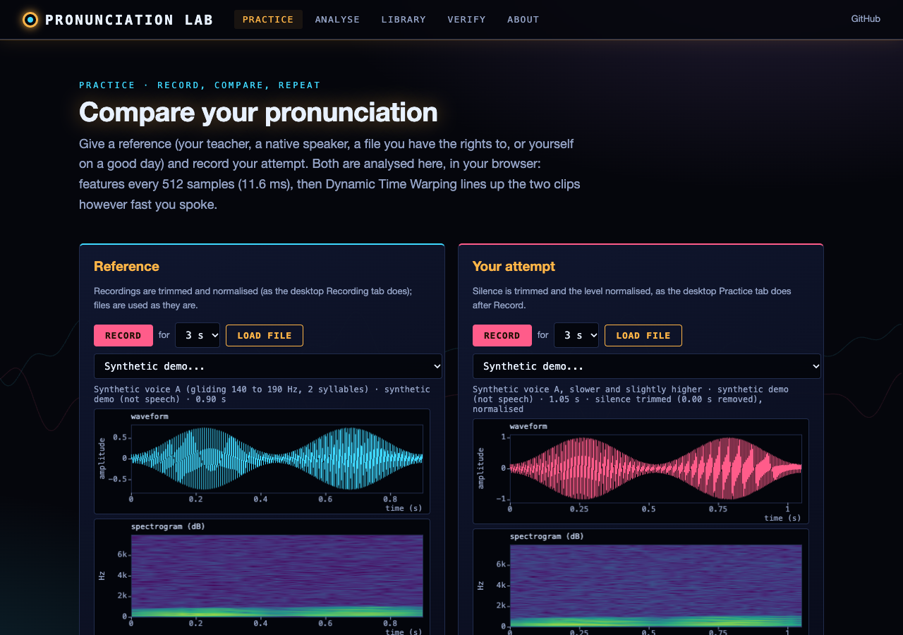
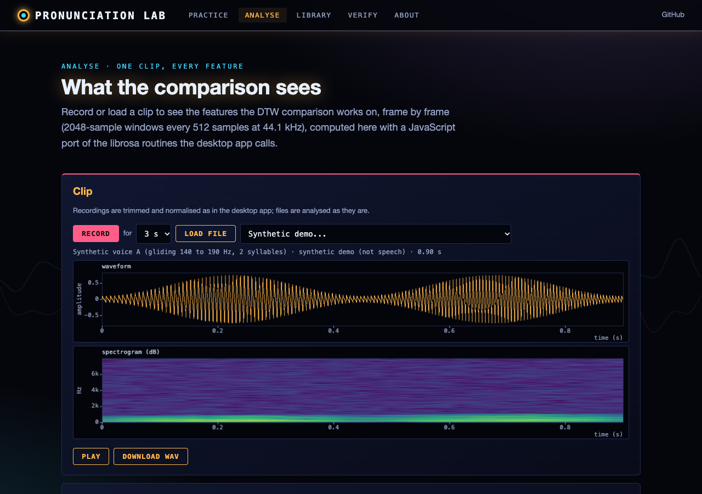
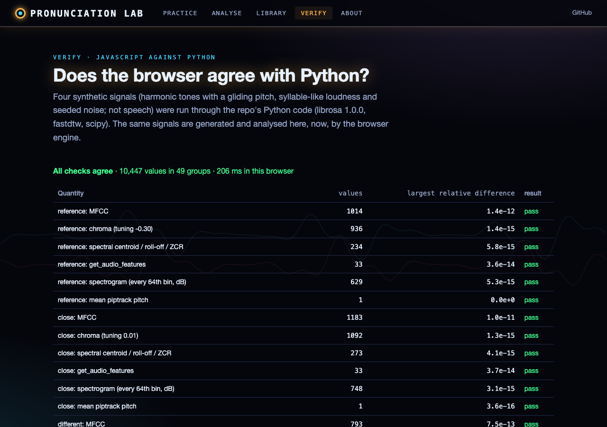

# Language Learning Pronunciation Tool

A modular Python application for learning foreign language pronunciation through audio recording, waveform visualization, and AI-powered comparison using Dynamic Time Warping (DTW).

## 🎯 Features

### Core Capabilities
- **Audio Recording & Playback**: Record your pronunciation and play reference samples
- **Waveform Visualization**: Real-time waveform and spectrogram display
- **DTW-Based Comparison**: Compare your pronunciation with native speakers using Dynamic Time Warping
- **Similarity Scoring**: Get instant feedback with scores (0-100) and detailed analysis
- **Database Management**: Store and organize pronunciation samples with metadata
- **Internet Download**: Download pronunciation samples from Forvo and other sources
- **Practice Tracking**: Monitor your progress with practice history and statistics

### Technical Features
- **Modular Architecture**: Each component is independently testable
- **PyQt5 GUI**: Professional tabbed interface with matplotlib integration
- **Multiple Analysis Methods**: MFCC, chroma, spectral features for comprehensive comparison
- **SQLite Database**: Efficient local storage with full search capabilities
- **Unit Tests**: Comprehensive test suite for all core modules

## 🧪 Based on Research

This tool incorporates findings from recent language learning research:
- **Visual Feedback**: Studies show visual feedback significantly improves pronunciation learning
- **High Variability Training**: Exposure to multiple speakers enhances learning
- **DTW for Pronunciation**: Proven effective in Computer-Assisted Pronunciation Training (CAPT)
- **Immediate Feedback**: Real-time analysis helps learners correct errors quickly

## 📋 Requirements

- Python 3.7 or higher
- Audio input device (microphone)
- Operating System: Windows, macOS, or Linux

## 🚀 Installation

1. **Clone or download this repository**

2. **Install dependencies:**
```bash
pip install -r requirements.txt
```

Required packages:
- numpy
- scipy
- matplotlib
- soundfile
- sounddevice
- librosa
- fastdtw
- PyQt5
- requests

3. **Run the application:**
```bash
python run.py
```
(or `cd src && python main_gui.py`)

## 📖 Usage Guide

### Practice Tab

1. **Enter a word or phrase** you want to practice
2. **Select the language** from the dropdown
3. **Load a reference** pronunciation:
   - From database (if available)
   - Or from a file on your computer
4. **Play the reference** to hear the correct pronunciation
5. **Record your attempt** (3 seconds)
6. **Click "Compare"** to analyze your pronunciation
7. **Review feedback**: Similarity score, speed, pitch, and volume analysis

### Library Tab

- **Browse** all stored pronunciation samples
- **Search** for specific words
- **Play** any sample
- **Add new samples** from audio files
- Organize samples by language and category

### Understanding the Visualizations

**Waveform (Top):**
- Shows amplitude over time
- Helps visualize timing and rhythm
- Peaks indicate louder sounds

**Spectrogram (Bottom):**
- Shows frequency content over time
- Brighter colors = stronger frequency components
- Speech typically ranges 100-8000 Hz
- Helps visualize pitch, intonation, and phoneme articulation

## 🌐 Web version

**Live site: https://gddickinson.github.io/language_learning_tool/** (published from `main` by `.github/workflows/pages.yml`).

The static site is the tool itself: record with the microphone (only after you press Record) or load an audio file,
and the waveform, spectrogram, MFCC / chroma / spectral features and the DTW comparison are computed in your browser.
Audio never leaves the page. The analysis is a JavaScript port of this repo's Python pipeline (librosa MFCC, chroma
with tuning estimate, spectral centroid / roll-off / ZCR, piptrack, fastdtw, the DTW warping and the Practice tab's
report), checked against the Python results on synthetic signals (`web/static/engine.test.mjs`, and the **Verify**
page in the browser; largest difference about 1e-11).

No reference recordings ship with the repository: use a recording you have the rights to, record a teacher or native
speaker with their permission, or record yourself. The synthetic demo clips are generated tones, not speech.

| Practice | Analyse | Verify |
|---|---|---|
|  |  |  |

### Run the web app locally

```bash
pip install -r requirements-web.txt
python run_web.py            # http://127.0.0.1:8163
```

The local app adds **Check with Python** on the Practice page (the same two clips through `src/dtw_comparator.py`)
and the **Library** page (your desktop sample database, read-only). Tests: `python -m pytest -q tests` and
`node web/static/engine.test.mjs`; `python scripts/build_static.py` writes the static site to `site/`.

Not in the web version: the Live Comparison tab, pYIN pitch, saving to the database, statistics and the Forvo
downloader (needs your API key; stays in the desktop app).

## 🔧 Module Documentation

### AudioProcessor (`audio_processor.py`)

Handles all audio operations:
- Recording and playback
- File I/O (WAV, MP3, OGG, FLAC)
- Waveform and spectrogram generation
- Feature extraction (MFCC, pitch, spectral features)
- Audio preprocessing (normalization, silence trimming)

**Usage:**
```python
from audio_processor import AudioProcessor

processor = AudioProcessor()

# Record 3 seconds
audio = processor.record(3.0)

# Get waveform
time, amplitude = processor.get_waveform(audio)

# Get spectrogram
freqs, times, spec = processor.get_spectrogram(audio)

# Extract features
features = processor.get_audio_features(audio)
```

### DTWComparator (`dtw_comparator.py`)

Compares pronunciations using Dynamic Time Warping:
- Multi-feature comparison (MFCC, chroma, spectral)
- Similarity scoring (0-100 scale)
- Detailed error analysis (speed, pitch, volume)
- Handles different speaking speeds

**Usage:**
```python
from dtw_comparator import DTWComparator

comparator = DTWComparator()

# Compare two audio samples
results = comparator.compare_multiple_features(user_audio, reference_audio)
print(f"Similarity: {results['similarity_score']}/100")

# Get detailed analysis
analysis = comparator.analyze_pronunciation_errors(user_audio, reference_audio)
print(analysis['feedback'])
print(analysis['speed_feedback'])
```

### DatabaseManager (`database_manager.py`)

Manages pronunciation sample database:
- SQLite-based storage
- Full metadata support
- Search and filtering
- Practice history tracking
- Statistics generation

**Usage:**
```python
from database_manager import DatabaseManager

db = DatabaseManager()

# Add a sample
sample_id = db.add_sample(
    word='hello',
    language='en',
    filepath='/path/to/hello.wav',
    source='forvo',
    speaker='native_speaker'
)

# Get samples
samples = db.get_samples(word='hello', language='en')

# Track practice
db.add_user_recording(
    word='hello',
    language='en',
    filepath='/path/to/my_hello.wav',
    reference_id=sample_id,
    similarity_score=85.5
)

# Get statistics
stats = db.get_statistics()
```

### SampleDownloader (`downloader.py`)

Downloads samples from online sources:
- Forvo API integration (requires API key)
- Batch downloading
- Suggested vocabulary by category
- Metadata retrieval

**Usage:**
```python
from downloader import SampleDownloader

downloader = SampleDownloader(api_key='your_forvo_api_key')

# Search Forvo
results = downloader.search_forvo('hello', 'en', limit=5)

# Download pronunciation
filepath = downloader.download_forvo_pronunciation('hello', 'en')

# Get suggested words
greetings = downloader.get_suggested_words('greetings')
```

## 🧪 Running Tests

Run all unit tests:
```bash
cd tests
python -m unittest discover
```

Run specific test module:
```bash
python -m unittest test_audio_processor
python -m unittest test_dtw_comparator
python -m unittest test_database_manager
```

## 🎓 Understanding DTW (Dynamic Time Warping)

DTW is a powerful algorithm for comparing time-series data with different speeds or timings. It's perfect for pronunciation comparison because:

1. **Handles Speed Variations**: Compares patterns even if spoken at different speeds
2. **Finds Optimal Alignment**: Automatically aligns similar parts of two pronunciations
3. **Robust to Timing Differences**: Works even with pauses or hesitations
4. **Multi-dimensional**: Can compare multiple audio features simultaneously

The tool uses DTW on three feature types:
- **MFCC** (Mel-Frequency Cepstral Coefficients): Captures phonetic content
- **Chroma**: Represents harmonic/tonal content
- **Spectral**: Frequency distribution characteristics

## 📊 Interpretation Guide

### Similarity Scores

Each feature set (MFCC, chroma, spectral) is put on a common scale, aligned with DTW, and its per-frame distance d
turned into a 0-100 match `100 * exp(-d / d0)`; the score is the weighted mean (0.5 / 0.3 / 0.2). The d0 values in
`src/config.py` come from `scripts/calibrate_score.py`: time-stretched or slightly pitch-shifted copies of a synthetic
voice score 74-96, unrelated signals 3-25 (synthetic calibration, not a learner corpus).

- **90-100**: Excellent - Very accurate pronunciation
- **75-89**: Good - Quite close to native pronunciation
- **60-74**: Fair - Recognizable but needs improvement
- **40-59**: Needs work - Some similarities but practice required
- **0-39**: Significant differences - Keep practicing!

### Feedback Categories

**Speed Feedback:**
- Too fast/slow indicates speaking rate differs from reference
- Aim for natural, relaxed pace

**Pitch Feedback:**
- Indicates if your tone/intonation differs
- Important for tonal languages

**Volume Feedback:**
- Helps maintain consistent recording levels
- Ensures fair comparison

## 🔑 Getting Forvo API Key (Optional)

To download pronunciations from Forvo:

1. Visit [Forvo API](https://api.forvo.com/)
2. Register for a free account
3. Get your API key
4. Add to `config.py`: `FORVO_API_KEY = 'your_key_here'`

## 📁 Project Structure

```
language_learning_tool/
├── src/
│   ├── config.py              # Configuration settings
│   ├── audio_processor.py     # Audio recording & analysis
│   ├── dtw_comparator.py      # Pronunciation comparison
│   ├── database_manager.py    # Database operations
│   ├── downloader.py          # Internet download functionality
│   └── main_gui.py            # PyQt5 GUI application
├── tests/
│   ├── test_audio_processor.py
│   ├── test_dtw_comparator.py
│   └── test_database_manager.py
├── data/
│   ├── samples/               # Downloaded samples
│   ├── temp/                  # Temporary files
│   └── samples.db             # SQLite database
├── requirements.txt
└── README.md
```

## 🎯 Tips for Best Results

1. **Recording Environment**: Use a quiet space with minimal background noise
2. **Microphone Distance**: Keep consistent distance from microphone
3. **Listen First**: Always listen to the reference before recording
4. **Multiple Attempts**: Practice makes perfect - record multiple times
5. **Focus Areas**: Pay attention to speed, pitch, and rhythm feedback
6. **Use Visualization**: Watch the spectrogram to match frequency patterns

## 🚧 Future Enhancements

Potential additions:
- Speech-to-text integration
- Phoneme-level analysis
- Gamification elements
- Cloud synchronization
- Mobile app version
- More language-specific features

## 📚 References

This tool is based on research in:
- Computer-Assisted Pronunciation Training (CAPT)
- Dynamic Time Warping for speech recognition
- Visual feedback in language learning
- High Variability Phonetic Training (HVPT)

## 📝 License

MIT licence (see `LICENSE`).

## 🤝 Contributing

Contributions welcome! Areas of interest:
- Additional language support
- More audio analysis features
- UI/UX improvements
- Performance optimization
- Documentation enhancements

## ❓ Troubleshooting

**Issue: No audio recording**
- Check microphone permissions
- Verify default audio device in system settings
- Test with `sounddevice.query_devices()`

**Issue: Poor similarity scores**
- Ensure quiet recording environment
- Check microphone levels
- Try different reference samples
- Practice pronunciation slowly first

**Issue: Import errors**
- Verify all dependencies installed: `pip list`
- Check Python version >= 3.7
- Try installing in virtual environment

**Issue: GUI doesn't start**
- Verify PyQt5 installation
- Check matplotlib backend compatibility
- Try: `export QT_QPA_PLATFORM=offscreen` on headless systems

## 📧 Support

For issues, questions, or suggestions, please check the documentation or create an issue in the repository.

---

**Happy learning! 🌍🗣️**


---
*Built with AI assistance from [Claude (Anthropic)](https://claude.com/).*
